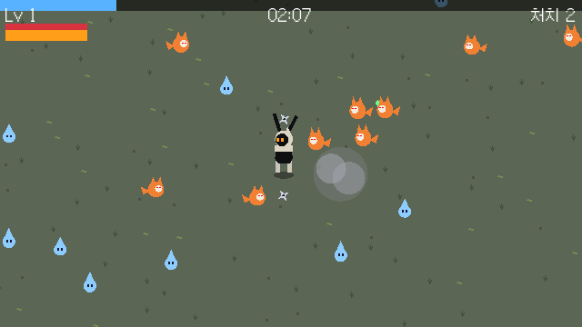

# 킬비 (가제)

검은 토끼 닌자 킬비가 몰려오는 요괴 사이에서 살아남는 자동 공격 서바이벌 게임입니다. 지금은 **프로토타입**입니다.



## 실행하기

1. [Godot 4](https://godotengine.org/download) (4.3 이상, 일반 버전)을 설치합니다.
2. Godot을 열고 **가져오기(Import)** → 이 폴더의 `project.godot`을 선택합니다.
3. 오른쪽 위 ▶ 버튼(F5)으로 실행합니다.

## 조작

| 동작 | 키보드 | 게임패드 |
| --- | --- | --- |
| 이동 | WASD / 방향키 | 왼쪽 스틱 |
| 대시 | Space / Shift | A |
| 특수 스킬 | Q / E | Y |
| 일시정지 | Esc / P | Start |
| 레벨업 선택 | 마우스, 방향키+Enter, 숫자 1~3 | 방향 + A |

## 암살자 시스템

- **특수 스킬:** 판 시작 전에 하나를 골라 들고 간다(판 중에는 바꿀 수 없음).
    - **그림자 은신** (Q, 20초): 2초간 사라진다. 적은 마지막으로 본 자리로 몰려가고, 은신 중에는 쿠나이를 던지지 않는다. 은신이 끝난 뒤 첫 쿠나이 공격은 기습 치명타(피해 3배, 관통 +2). 준비되면 킬비 눈이 붉게 빛난다.
    - **통나무 둔갑** (자동, 25초): 적에게 맞는 순간 피해를 무효로 하고, 그 자리에 통나무를 남긴 채 근처 빈자리로 순간이동한다. 통나무는 2초간 적을 끌어모은 뒤 터진다.
- **대시:** 회피 전용, 쿨타임 2초.
- **암살 표식:** 쿠나이에 맞은 적에게 표식이 쌓이고, 3개(표적은 6개)가 되면 즉시 처형된다.
- **표적 의뢰:** 45초부터 1분마다 붉은 표적 표시가 붙은 강한 여우가 나온다. 30초 안에 잡으면 보물 상자(레벨업 1~3회), 놓치면 도망간다.
- **처형 연출:** 붉은 베기 선, 히트스톱, 흑백 번쩍임. 화면 전체에 달빛 비네팅.

## 진화 무기

무기가 최대 레벨(8)이고 짝 패시브를 1레벨 이상 갖고 있으면, 다음 보물 상자(표적 처치 보상)에서 진화한다.

| 진화 무기 | 재료 | 효과 |
| --- | --- | --- |
| 쿠나이 폭풍 | 쿠나이 + 손목 붕대 | 조준 사격과 함께 8방향(+투사체 보너스×2)으로 쿠나이를 퍼붓는다. 피해 1.5배, 쿨타임 30% 감소 |
| 혼돈의 고리 | 표창 + 검은 털 | 표창 수 2배, 안팎 두 겹 고리가 반대로 돈다. 피해 1.5배 |
| 그림자 안개 | 연기탄 + 스파이크 목걸이 | 킬비를 따라다니는 영구 안개. 0.5초마다 피해, 감속, 암살 표식 |

손목 붕대(투사체 +1)는 최대 5레벨까지 쌓을 수 있다.

## 프로토타입에 들어간 것

- 이동, 대시(3초 쿨타임, 대시 중 무적)
- 무기 3종: 쿠나이(시작 무기), 표창, 연기탄. 각각 최대 8레벨
- 패시브 6종: 손목 붕대, 검은 털, 스파이크 목걸이, 주황 부적, 단련된 다리, 긴 귀
- 적 2종: 도깨비불(추적), 여우 자객(돌진). 1분부터 여우 등장, 2분 30초에 포위 웨이브
- 경험치 보석, 레벨업 3지선다, 체력·경험치·시간·처치 수 표시
- 5분 생존하면 클리어, 쓰러지면 게임 오버, 다시 하기

아직 없는 것: 보스, 메타 성장, 사운드, 실제 스프라이트, 적끼리 밀어내기.

## 폴더 구조

```
scenes/main.tscn          시작 씬 (main.gd 하나만 붙어 있음)
scripts/game_data.gd      밸런스 수치와 이름 (숫자는 여기서 고치기)
scripts/main.gd           스폰, 레벨업, 게임 오버, 입력 설정
scripts/player.gd         킬비 이동·대시·체력·경험치
scripts/kilvi_visual.gd   킬비 임시 그림 (스프라이트로 교체할 곳)
scripts/enemy.gd          적 행동과 임시 그림
scripts/xp_gem.gd         경험치 보석
scripts/weapons/          무기 3종과 투사체
scripts/ui/               HUD, 레벨업 화면, 메뉴
scripts/background.gd     임시 바닥
scripts/treasure_chest.gd 표적 보상 상자
scripts/effects/          대시 연기, 처형 베기 선, 통나무
scripts/ui/post_fx.gd     달빛 비네팅, 처형 흑백 효과 (셰이더)
assets/fonts/             갈무리11 폰트 (SIL OFL, 상업 이용 가능)
art/                      직접 그린 스프라이트를 넣을 곳
```

## 스프라이트 넣는 법 (간단 버전)

1. 그린 PNG를 `art/kilvi/` 같은 폴더에 넣습니다. 오른쪽을 보는 모습만 그리면 됩니다.
2. `scripts/player.gd`의 `_ready()`에서 `KilviVisual` 대신 `AnimatedSprite2D`를 만들고 SpriteFrames에 애니메이션(idle, run, hit, dash, death)을 등록합니다.
3. 첫 스프라이트가 나오면 이 작업은 Claude가 해 드릴 수 있습니다.

기준 해상도는 640×360이고, 창 크기는 1280×720(정수 배율 확대)입니다. 크기 목록은 설계 문서의 "스프라이트 아트 목록"을 참고하세요.

## 폰트 라이선스

갈무리(Galmuri) 폰트는 SIL Open Font License 1.1을 따릅니다. 전문은 `assets/fonts/Galmuri-OFL.md`에 있습니다.
